# Shift 2026 · Summit Hispana de Inversiones, Finanzas y Trading — Bogotá

**Fecha:** 8 y 9 de noviembre de 2026 · **Tipo:** Conferencia · **Tema:** Negocios / Inversión · **Fuente:** 125 fotos (47 de slides y 78 vía WhatsApp, incluidas tus notas manuscritas)
**Ponentes:** Hyenuk Chu · Jorge Iván Ocampo · Xavier Illingworth · Luis Ángel Hernández · Mariel Lang Sáez · panel de cierre

---

## Resumen en 30 segundos

Shift 2026 giró sobre una idea: **construir patrimonio con reglas, no con impulsos** (#nofastmoney). La mitad de las charlas atacó el *cómo invertir* (núcleo pasivo + satélites, cartera permanente, seguimiento de tendencia de Faber, ETFs UCITS para Latam). La otra mitad, el *cómo operar y automatizar* (estrategias con reglas medibles, backtest sin trampas, IA como orquestador con Claude Code). El bloque humano (Ocampo, Illingworth, Chu) cerró el círculo: el dinero es un medio, no el propósito.

---

## SECCIÓN 1: Resumen de Valor

### 📌 Ideas Clave / Key Takeaways

1. **Núcleo + satélites es la arquitectura base.** 60–80 % en un núcleo pasivo, barato y diversificado (Treynor y Black, 1973); 20–40 % en satélites con propósito (regiones, sectores, tamaño/estilo, oro y materias primas). La fase del ciclo no cambia el núcleo: solo inclina los satélites 5–10 puntos.
2. **Ninguna cartera gana en los cuatro regímenes.** 2020 recesión (ganó el oro), 2021 reflación (energía +56 %), 2022 estanflación (S&P −18,1 % y bonos −13 % a la vez: se rompió la 60/40), 2023-24 Goldilocks (acciones y tecnología). Elige la cartera que puedas sostener, no la que ganó el último año.
3. **Una estrategia solo existe si se puede escribir con números.** «Cuando esté barato» → RSI(2) < 15; «cuando haya tendencia» → cierre > media de 200 días; «salgo cuando gane bastante» → 2 cierres al alza; «arriesgo poco» → 1 % del capital. Estrategia = reglas; sistema = reglas + riesgo + vigilancia; algoritmo = todo ejecutado por una máquina.
4. **La IA ejecuta, tú decides.** En el duelo de Mariel Lang (100.000 USD cada uno, 2 ene – 11 sep 2026), sus sistemas con reglas terminaron en 165.147 USD; Claude con libertad total, 105.063; Gemini, 81.172; DeepSeek, 57.042. La IA escribe el código, corre las pruebas y lo documenta; **no** elige tu idea, no debe bajar el listón para que pase y no decide cuánto arriesgas.
5. **Para Latam, el vehículo importa tanto como el activo.** ETFs UCITS domiciliados en Irlanda: retención de dividendos del 15 % vs 30 % en ETFs de EE. UU., y evitas el impuesto de sucesiones de EE. UU. (exención de solo 60.000 USD para no residentes; el exceso tributa hasta 40 %). Validar siempre con un contador local.

### 💡 Insights de Crecimiento Personal / Liderazgo

- **«No traicionaste tu pasado: cumplió su función, que era traerte hasta aquí.»** (Hyenuk Chu). Crecer implica dejar de encajar donde empezaste, y eso es una buena señal.
- **No hay un lugar al que llegar.** El éxito no es la cifra final, sino un proceso que puedes disfrutar hoy. Las rachas buenas y las malas pasan, y mucho antes de lo que crees.
- **El problema no es el dinero, es convertirlo en el propósito** (Jorge Iván Ocampo). El dinero es un medio para vivir con dignidad, cuidar a la familia, crear empresa, generar empleo y ayudar a otros. Lo que no se recupera: relaciones, salud, tranquilidad y tiempo.
- **Tres anclas para decidir: claridad, criterio y responsabilidad.** Pregunta para llevarte: *¿qué decisión importante en tu vida está esperando una respuesta que quizás nunca llegará?*
- **Un portafolio de vida balanceado** (Xavier Illingworth): dinero (libertad y opciones), salud (energía), relaciones (apoyo), tiempo (presencia) y propósito (legado). Mentalidad de siguiente nivel: soltar el «hacer» constante, gestionar el vacío del logro, redefinir el éxito y diseñar una vida con sentido.
- **Ingresos, habilidades y propiedad de activos.** Los ingresos cubren las cuentas de hoy, las habilidades suben los ingresos de mañana y la propiedad captura valor durante décadas: hay que construir las tres. Y una idea de tus notas: *«no es de gobernantes, es tu decisión»*. Cuida tu microeconomía personal aunque el país vaya mal.

---

## Repaso por charla

### 1. Hyenuk Chu: «Ya no encajas donde empezaste» y carteras para todos los regímenes
- **Mensaje humano:** el pasado cumplió su función; no existe «llegar»; disfrutar el proceso; «esto también pasará».
- **Ciclo económico** (reloj de inversión de Merrill Lynch): reflación → bonos, recuperación → acciones, sobrecalentamiento → materias primas, estancamiento → efectivo. Primero se mueve la bolsa y después la economía. La inflación no baja, se desacelera (se acumula).
- **Por qué murió la 60/40 en 2022:** con inflación sostenida por encima de ~3 %, acciones y bonos caen juntos. Sus «20 años dorados» venían del Tesoro a 10 años pasando de 15 % (1981) a ~0 % (2020) y de la correlación negativa desde 2000.
- **Cartera Permanente de Harry Browne:** 25 % acciones (gana en Goldilocks), 25 % bonos largos (recesión), 25 % letras cortas (estanflación) y 25 % oro (reflación).
  - Su ventaja es caer poco: inflación de los 70, −45 % la bolsa vs −11 % la permanente; 2008, −54 % vs −12 %; COVID, −34 % vs −9 %.
  - Recuerda que una caída del 50 % exige +100 % para recuperarse. En Japón, la bolsa tardó 30 años en recuperar su máximo y la cartera permanente, 6.
  - Rentabilidad esperada de ~4 % real anual. Falló en 2022 por los bonos largos. Para Latam, usar la versión en USD. Es para perfiles desde los 45–50 años o cerca de la jubilación.
- **Un índice solo no basta:** ~70 % del MSCI World está en EE. UU. S&P 500 + MSCI World no diversifican. Satélites que corrigen: emergentes, Europa, salud, energía, small caps y oro.
- **Cartera conservadora de ejemplo:**
  - 64 % renta variable (MSCI World + Europa, emergentes, salud, energía, small caps).
  - 28 % renta fija gubernamental de alta calidad, con duración de ~3,7 años.
  - 8 % materias primas (índice amplio).
  - Costo total ponderado de ~0,17 % anual. Validación con X-ray (región, sector, volatilidad, beta, correlaciones).
- **El proceso en 5 pasos:**
  1. Perfil (¿qué caída aguantas sin vender?).
  2. Asignación por clase de activo.
  3. Núcleo + satélites.
  4. X-ray.
  5. Rebalanceo con reglas escritas.
- **El orden correcto para empezar:**
  1. Fondo de emergencia de 6–12 meses de gastos (cuenta remunerada, fondo monetario o letras cortas).
  2. Núcleo de renta variable global, diversificado y barato (fondos indexados o ETF).
  3. Renta fija corta, si la volatilidad asusta.
  4. Oro, 5–7 %, como descorrelacionador.
  5. REITs, Bitcoin y temáticas, solo como satélites pequeños y entendiendo su riesgo.
- **Seguimiento de tendencia (Mebane Faber, GTAA):**
  - 5 activos al 20 %: VTI, VXUS, BND, IYR y GSG.
  - Se revisa el último día hábil del mes. Si el activo cierra bajo su media móvil de 10 meses, ese 20 % pasa a efectivo.
  - En el paper, la GTAA rinde 6,01 % vs 3,94 % de buy & hold, con caída máxima de −9,42 % vs −46 %.
- **Cuatro estrategias lado a lado:**

| | 60/40 | Permanente | Núcleo-satélite | Faber (tendencia) |
|---|---|---|---|---|
| Regímenes | 2 de 4 | Los 4 | Los 4, si los satélites se eligen bien | Sale del mercado en caídas largas |
| Rentabilidad | Media | Baja-media (~4 % real) | Media-alta, según el núcleo | Cercana a la renta variable, con menos caída |
| Gestión | Rebalanceo | Rebalanceo anual | Núcleo fijo, satélites tácticos | Revisión mensual |
| Perfil | Moderado | Conservador | Cualquiera | Disciplinado |

- **5 ideas para llevarse:**
  1. Invertir es una obligación: el dinero quieto se empobrece.
  2. Diversificar es combinar activos que no se mueven igual.
  3. Ninguna cartera gana en todos los regímenes.
  4. Los costos importan tanto como la estrategia.
  5. Construir patrimonio, no buscar el pelotazo.
- **Demo de análisis de empresa (NU Holdings)** con la estructura descripción → Latam → ventaja competitiva → riesgos → finanzas → oportunidades → valoración.
  - Colombia: 2,5 millones de clientes; ~75 % de los colombianos aún usa efectivo; ahorro al 13 %.
  - Escenarios: bull +807 % a 2032, base ×5 y bear ×3, con múltiplos de 24x (2025) y 22,5x (2026).
- **Track record público:** Kinfo y eToro (+30 % en 2026). Según tus notas, pasó de 8K a 154K con intradía/scalping y opciones sobre SPX, y opera swing en eToro.

### 2. Jorge Iván Ocampo: «Liderar es hacer que las cosas pasen»
- ¿Para qué trabajamos tanto, construimos empresas y acumulamos patrimonio? Y sobre todo, ¿qué estamos sacrificando mientras tanto?
- El dinero es un medio. Lo que no se recupera: relaciones, salud, tranquilidad y tiempo.
- Tres anclas para decidir: **claridad, criterio y responsabilidad.**
- Ejercicio: identifica la decisión importante que estás postergando y respóndete a ti mismo.

### 3. Xavier Illingworth: «Cuando el dinero ya no es la meta»
- Preguntas clave: ¿qué quiero realmente?, ¿qué me motiva hoy?, ¿cómo quiero vivir mi tiempo? y ¿qué legado quiero dejar?
- **Liberar lo que te limita:** perdonar y soltar cargas del pasado, soltar exigencias y perfeccionismo, dejar el control y confiar en el proceso, usar autohipnosis y recuperar tu energía y libertad interior.
- **Diseñar tu siguiente capítulo:** clarificar tu visión de vida, definir proyectos que te emocionen, tomar decisiones valientes, crear un plan simple y concreto, y avanzar con enfoque y disciplina.

### 4. Luis Ángel Hernández: «Pasado, presente y futuro de la industria de ETFs»
- Tendencia: ETPs con estrategia de **opciones covered call**, por ejemplo IncomeShares NVIDIA (NVDI), con distribución mensual y un *distribution yield* mostrado de 75,8 %. También TSLI (Tesla) y GLDI (oro).
  - Ojo: ese rendimiento no es ganancia neta. Es prima de opciones a cambio de ceder la subida.
- En Latam, el vehículo importa: elegir donde exista liquidez. Tus notas indican que los UCITS son algo más costosos, pero fiscalmente más eficientes para no residentes en EE. UU.
- Bibliografía: ver la sección de libros.

### 5. Mariel Lang Sáez (Trade It Simple): «Inteligencia artificial en trading»
- **Tradicional vs rule based:**
  - Tradicional (Livermore, Soros, Tudor Jones): se adapta y lee contexto, pero no se mide, no escala y depende de cómo amaneciste.
  - Rule based (Richard Dennis, Ed Thorp, Jim Simons): se mide antes de arriesgar un dólar y opera igual el lunes que el viernes, pero tarda en adaptarse y hay que aguantar sus rachas.
- **Regla escrita n.º 1: RSI(2) de Larry Connors** sobre el Nasdaq 100 diario, 4 reglas:
  1. Cierre > media de 200.
  2. RSI(2) < 15, compra en la apertura siguiente.
  3. Sale tras 2 cierres al alza.
  4. 1 % de riesgo por operación.
  - Resultado: +317 % (2008–2026), 8,1 % anual, peor caída −17 %, 207 operaciones.
- **Regla escrita n.º 2: Dual Momentum de Gary Antonacci.** A fin de cada mes compara S&P 500, mundo y bonos con 12 meses de retrovisor y se queda con el mejor; si ninguno supera la liquidez, todo a bonos.
  - Resultado: +495 % (2004–2026), 8,4 % anual, peor caída −34 % vs −55 % del S&P 500.
- **El código bien hecho puede ser absoluto:** el error típico es comprar a la apertura de hoy con el cierre de hoy (*look-ahead bias*). Curva perfecta = mentira.
  - Objetivos + metodología + IA = código en el que confías.
- **Antes vivíamos en un mundo code-constrained:** 1983 papel (meses por idea) → 2017-23 Excel (semanas) → 2026 método + IA (horas por idea).
- **Los 5 niveles de un sistema de trading:**
  1. Reglas escritas.
  2. Backtest.
  3. Forward test.
  4. Algoritmo.
  5. En la nube, monitoreado.
- **Ocho fases, ninguna se salta.** Si falla en cualquier fase, se descarta.
  1. AED (¿cómo se comporta el activo?).
  2. Hipótesis (¿qué explotas y por qué existe?).
  3. Reglas (¿escritas sin dudas?).
  4. Backtest (¿pasa los 4 números?).
  5. Optimizar (¿funciona en una meseta?).
  6. Robustez (¿aguanta lo malo?).
  7. Riesgo (¿cuánto merece?).
  8. Incubar (dinero real, pero poco).
- **Niveles de uso de la IA, «de plastilina a Miguel Ángel»:**
  1. Chat.
  2. Código (tú lo pegas).
  3. Repositorio con memoria.
  4. Agente que ejecuta tareas solo.
  5. Ecosistema de agentes, skills y reglas.
  6. Herramientas propias 24/7.
- **Tu primera mesa de trabajo con IA (40 min):**
  1. Instalar VS Code.
  2. Crear cuentas de GitHub y Claude.
  3. Instalar la extensión Claude Code.
  4. Abrir tu carpeta.
  5. Ver trabajar a tus agentes con la extensión «Pixel Agents».
- **Capas de la mesa:**
  - MCPs / conectores (Gmail, Calendar, Notion, Chrome, Canva).
  - Agentes, uno por tarea (revisor-protocolo, auditor-mt5, vigilante).
  - Skills, pasos fijos que no improvisan (validar-estrategia, publicar-estrategia).
  - CLAUDE.md con reglas (5 fases, «no bajar el listón»).
  - Repos de GitHub con historial.
- «Pensador + hacedor»: tú eres el pensador; la IA es tu orquestador.

---

## 📊 Datos clave y cifras para recordar

| Dato | Valor |
|---|---|
| Duelo IA 2026 (100.000 USD c/u, 2 ene – 11 sep) | Sistemas con reglas 165.147 · Claude 105.063 · Gemini 81.172 · DeepSeek 57.042 |
| 2022 (estanflación) | S&P 500 −18,1 % · Bloomberg US Aggregate −13,0 % · IPC EE. UU. pico 9,1 % (jun) |
| Recuperar una caída | −50 % exige +100 % |
| Cartera Permanente | ~4 % real anual · 2008: −12 % vs −54 % la bolsa |
| MSCI World | ~70 % en EE. UU. |
| Núcleo / satélites | 60–80 % / 20–40 % · el ciclo solo inclina satélites 5–10 pts |
| Cartera conservadora | 64 % RV · 28 % RF (dur. ~3,7 años) · 8 % materias primas · costo ~0,17 % anual |
| UCITS (Irlanda) vs ETF EE. UU. | Retención de dividendos 15 % vs 30 % · sucesiones: exención 60.000 USD, exceso hasta 40 % |
| RSI(2) Connors (Nasdaq 100) | +317 % 2008–2026 · 8,1 %/año · DD −17 % · 207 operaciones |
| Dual Momentum Antonacci | +495 % 2004–2026 · 8,4 %/año · DD −34 % (S&P −55 %) |
| GTAA Faber vs buy & hold | 6,01 % vs 3,94 % · DD −9,42 % vs −46 % |
| Fondo de emergencia | 6–12 meses de gastos |
| Oro en cartera | 5–7 % |
| NU Holdings (escenarios a 2032) | Bull +807 % · base ×5 · bear ×3 |

---

## 🔗 Links, herramientas y contactos

- **Paper de Mebane Faber, *A Quantitative Approach to Tactical Asset Allocation*:** https://papers.ssrn.com/sol3/papers.cfm?abstract_id=962461
- **Portfolio Visualizer** (backtest y modelo de medias móviles / TAA): https://www.portfoliovisualizer.com
- **VS Code:** https://code.visualstudio.com · extensión **Claude Code** · extensión **Pixel Agents** (ver trabajar a tus agentes)
- **TradingView** (gráficos usados en la demo de NU)
- **Kinfo** (track record verificado de Hyenuk Chu): https://kinfo.com/p/Hyenukchu · eToro: @hyenukchu
- **Mariel Lang Sáez:** @mariellangsaez (Instagram, X, YouTube, LinkedIn). Su QR «mis obreros» apuntaba a *mariellangsaez.tradeit…*; la URL completa no se lee en la foto.
- **Xavier Illingworth:** libro gratis *Rediseña tu vida*; escribe «LIBRO» a **@mentalizadorx** en Instagram.
- **Luis Ángel Hernández (Salud Financiera):** preguntas.saludfinanciera@gmail.com · WhatsApp +34 614 23 96 39
- **ETPs covered call de IncomeShares:** NVDI (NVIDIA), TSLI (Tesla), GLDI (oro)
- **Mencionados en tus notas (verificar):** app de renta fija de Elkin Galeano; «Tu renta», de Camilo Velásquez; Andrés Durán (tributación de inversiones: tarifa diferencial, el DCA difiere impuestos); Miguel Anxo Bastos (economista); Andrej Karpathy (a seguir).

---

## SECCIÓN 2: Formato Recordatorios de iOS (Apple Reminders)

### Lista: "📚 Libros por Leer"
- **Título del Recordatorio:** De cero a inversor en ETFs - Luis Ángel Hernández
  - **Notas:** Recomendado en Shift 2026. Contexto / Por qué leerlo: es el libro del ponente de ETFs, una guía práctica para armar tu núcleo indexado desde Latam.
- **Título del Recordatorio:** Una guía completa de los ETFs (2.ª ed.) - Joanne M. Hill y Elisabeth Kashner (CFA Institute Research Foundation)
  - **Notas:** Recomendado en Shift 2026. Contexto / Por qué leerlo: es la referencia técnica del CFA sobre cómo funcionan los ETF (estructura, costos, liquidez).
- **Título del Recordatorio:** ETPedia: The Ultimate Guide to Exchange-Traded Products - WisdomTree
  - **Notas:** Recomendado en Shift 2026. Contexto / Por qué leerlo: catálogo y mecánica de los ETP, incluidos los de opciones (covered call) que se mostraron.
- **Título del Recordatorio:** Guide to ETFs - J.P. Morgan Asset Management
  - **Notas:** Recomendado en Shift 2026. Contexto / Por qué leerlo: un repaso rápido y gratuito del ecosistema ETF.
- **Título del Recordatorio:** Thinking in Bets (Pensar en apuestas) - Annie Duke
  - **Notas:** Recomendado en Shift 2026 (según tus notas). Contexto / Por qué leerlo: decidir bien con incertidumbre, separando la calidad de la decisión de la del resultado.
- **Título del Recordatorio:** Algorithms to Live By - Brian Christian y Tom Griffiths
  - **Notas:** Recomendado en Shift 2026. Contexto / Por qué leerlo: aplica pensamiento algorítmico a decisiones cotidianas, en la misma línea que «ponerle número a la regla».
- **Título del Recordatorio:** Algorithmic Trading: Winning Strategies and Their Rationale - Ernest P. Chan
  - **Notas:** Recomendado en Shift 2026. Contexto / Por qué leerlo: estrategias rule based con su lógica estadística, la base para tus primeras reglas escritas.
- **Título del Recordatorio:** Advances in Financial Machine Learning - Marcos López de Prado
  - **Notas:** Recomendado en Shift 2026. Contexto / Por qué leerlo: cómo evitar el sobreajuste y el *look-ahead bias* al usar ML/IA en trading.
- **Título del Recordatorio:** Machine Learning for Algorithmic Trading (2.ª ed.) - Stefan Jansen
  - **Notas:** Recomendado en Shift 2026. Contexto / Por qué leerlo: un manual práctico en Python, de los datos al backtest, para llevar las reglas a código.
- **Título del Recordatorio:** Rediseña tu vida - Xavi Illingworth
  - **Notas:** Recomendado en Shift 2026. Contexto / Por qué leerlo: el ejercicio de «diseñar tu siguiente capítulo». Es gratis escribiendo LIBRO a @mentalizadorx.
- **Título del Recordatorio:** Options, Futures and Other Derivatives - John C. Hull
  - **Notas:** Recomendado en Shift 2026. Contexto / Por qué leerlo: la referencia para entender las opciones (covered call, SPX) antes de operarlas.
- **Título del Recordatorio:** Brownian Motion, Martingales, and Stochastic Calculus - Jean-François Le Gall
  - **Notas:** Recomendado en Shift 2026. Contexto / Por qué leerlo: base matemática avanzada de los modelos de precios (opcional, nivel técnico).
- **Título del Recordatorio:** Probability and Stochastics - Erhan Çınlar
  - **Notas:** Recomendado en Shift 2026. Contexto / Por qué leerlo: fundamentos de probabilidad para métodos cuantitativos (opcional, nivel técnico).
- **Título del Recordatorio:** Modeling and Analysis of Stochastic Systems - Vidyadhar G. Kulkarni
  - **Notas:** Recomendado en Shift 2026. Contexto / Por qué leerlo: modelado estocástico aplicado (opcional, nivel técnico).

### Lista: "🎯 Tareas & Acciones"
- **Título del Recordatorio:** Definir mi perfil: qué caída aguanto sin vender
  - **Fecha/Prioridad sugerida:** Alta | Esta semana
  - **Notas:** Paso 1 del proceso de Hyenuk Chu. Próximo paso: escribir un número (p. ej. −15 %) y la edad/horizonte; de ahí sale la cartera (60/40, permanente, núcleo-satélite o Faber).
- **Título del Recordatorio:** Verificar mi fondo de emergencia de 6–12 meses
  - **Fecha/Prioridad sugerida:** Alta | Esta semana
  - **Notas:** «El orden correcto para empezar», paso 01. Próximo paso: calcular mis gastos mensuales y moverlo a una cuenta remunerada o fondo monetario.
- **Título del Recordatorio:** Revisar si mis ETFs de EE. UU. deben pasar a UCITS (Irlanda)
  - **Fecha/Prioridad sugerida:** Alta | Próximas 2 semanas
  - **Notas:** Retención de dividendos 15 % vs 30 % y riesgo de sucesiones en EE. UU. por encima de 60.000 USD. Próximo paso: listar posiciones domiciliadas en EE. UU. y agendar una consulta con un contador local.
- **Título del Recordatorio:** Leer el paper de Faber y replicar la GTAA en Portfolio Visualizer
  - **Fecha/Prioridad sugerida:** Media | Próximas 2 semanas
  - **Notas:** Tarea que te dejaste en las notas. Próximo paso: backtest de VTI/VXUS/BND/IYR/GSG al 20 % con la media móvil de 10 meses; comparar contra buy & hold con impuestos.
- **Título del Recordatorio:** Hacer un X-ray de mi cartera actual
  - **Fecha/Prioridad sugerida:** Media | Próximo mes
  - **Notas:** Validar región, sector, volatilidad, beta y correlaciones. Próximo paso: comprobar cuánto de mi renta variable está en EE. UU./tecnología (MSCI World ≈ 70 % EE. UU.) y definir satélites que corrijan.
- **Título del Recordatorio:** Escribir mi regla de rebalanceo
  - **Fecha/Prioridad sugerida:** Media | Próximo mes
  - **Notas:** «Hay que escribir la regla». Próximo paso: fijar la frecuencia (anual o último día hábil del mes) y las bandas de desvío, y anotarlas.
- **Título del Recordatorio:** Montar mi primera mesa de trabajo con IA (40 min)
  - **Fecha/Prioridad sugerida:** Media | Esta semana
  - **Notas:** El tutorial de Mariel Lang: VS Code + GitHub + Claude Code + Pixel Agents. Próximo paso: crear un repo «sistemas-trading» con un CLAUDE.md que contenga las 8 fases y «no bajar el listón».
- **Título del Recordatorio:** Escribir con números mi primera estrategia y hacerle backtest
  - **Fecha/Prioridad sugerida:** Media | Próximo mes
  - **Notas:** Partir del RSI(2) de Connors o del Dual Momentum de Antonacci. Próximo paso: pasar cada frase subjetiva a una regla objetiva y revisar que el código no compre con datos del futuro.
- **Título del Recordatorio:** Responder: qué decisión importante estoy postergando
  - **Fecha/Prioridad sugerida:** Media | Esta semana
  - **Notas:** El cierre de Jorge Iván Ocampo. Próximo paso: escribirla y pasarla por las tres anclas (claridad, criterio, responsabilidad), con fecha límite para decidir.
- **Título del Recordatorio:** Evaluar mi portafolio de vida en 5 áreas
  - **Fecha/Prioridad sugerida:** Baja | Próximo mes
  - **Notas:** Ejercicio de Xavier Illingworth (dinero, salud, relaciones, tiempo, propósito). Próximo paso: puntuar cada una del 1 al 10 y elegir una acción para la más baja.
- **Título del Recordatorio:** Descargar el libro «Rediseña tu vida»
  - **Fecha/Prioridad sugerida:** Baja | Esta semana
  - **Notas:** Gratis. Próximo paso: enviar «LIBRO» por DM a @mentalizadorx en Instagram.
- **Título del Recordatorio:** Investigar los ETP covered call (NVDI, TSLI, GLDI) antes de invertir
  - **Fecha/Prioridad sugerida:** Baja | Este trimestre
  - **Notas:** Charla de Luis Ángel Hernández. Próximo paso: leer el fact sheet y entender que el yield alto viene de vender la subida, no de ganancia libre.

---

## Notas sobre el material
- Las fotos 048 y 060 son capturas largas de tus notas manuscritas que llegaron muy reducidas (≈92 px de ancho) y no son legibles. Si quieres incluirlas, súbelas de nuevo como imagen sin recortar.
- Fecha confirmada: el evento fue el 8 y 9 de noviembre de 2026. Los plazos de las tareas se calculan desde el 9/11.
- No hay foto de la portada de los libros técnicos de estocásticos; los títulos se tomaron del slide «Libros», que no muestra quién los recomendó.

---

## Anexo: fotos del evento
Las 125 fotos originales están en `entrada/2026-11-09-shift-2026/fotos/` (001–125). Hojas de contacto:

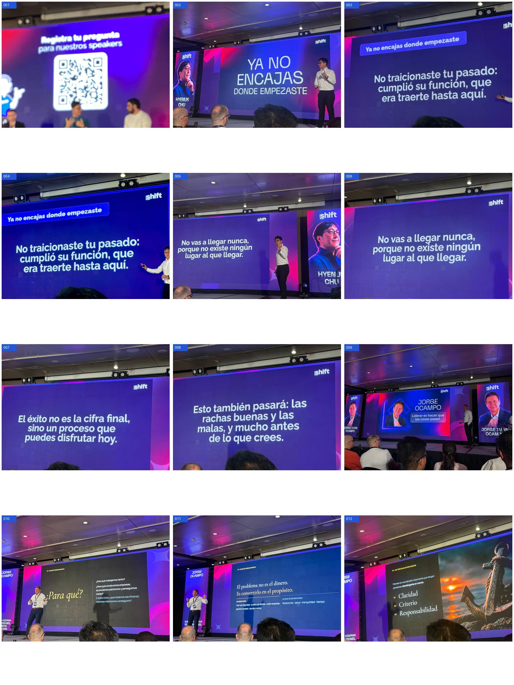
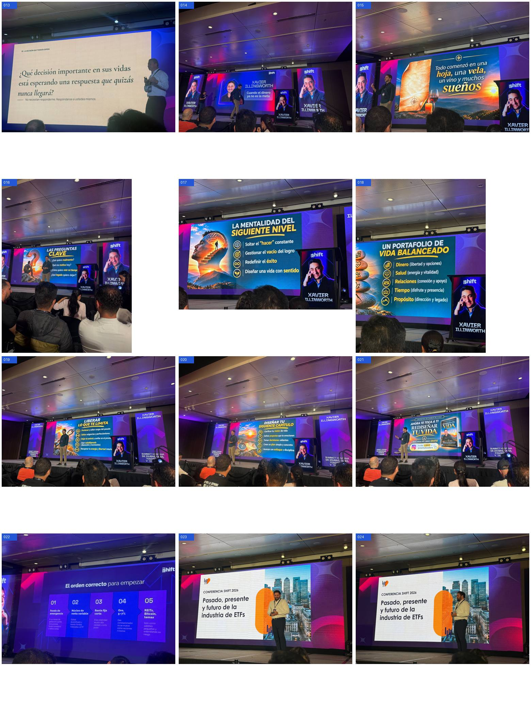
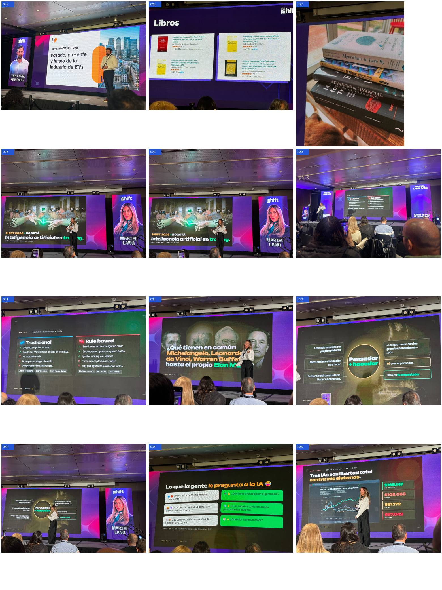
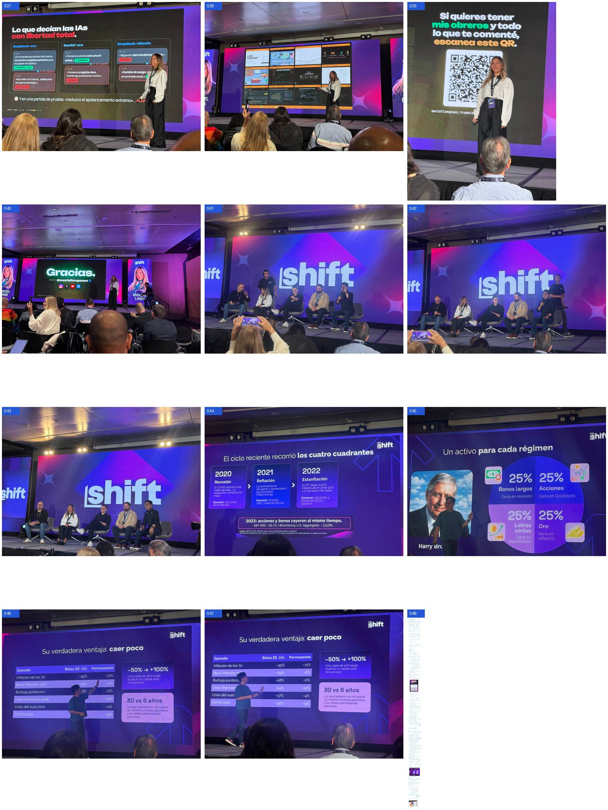
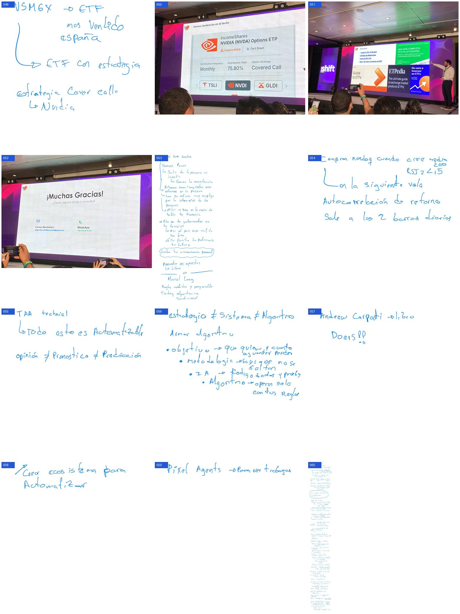
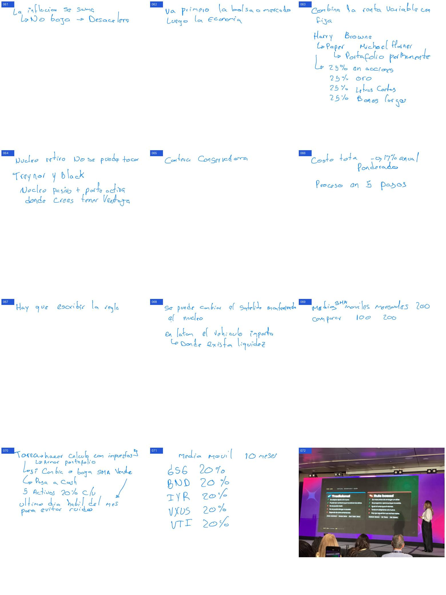
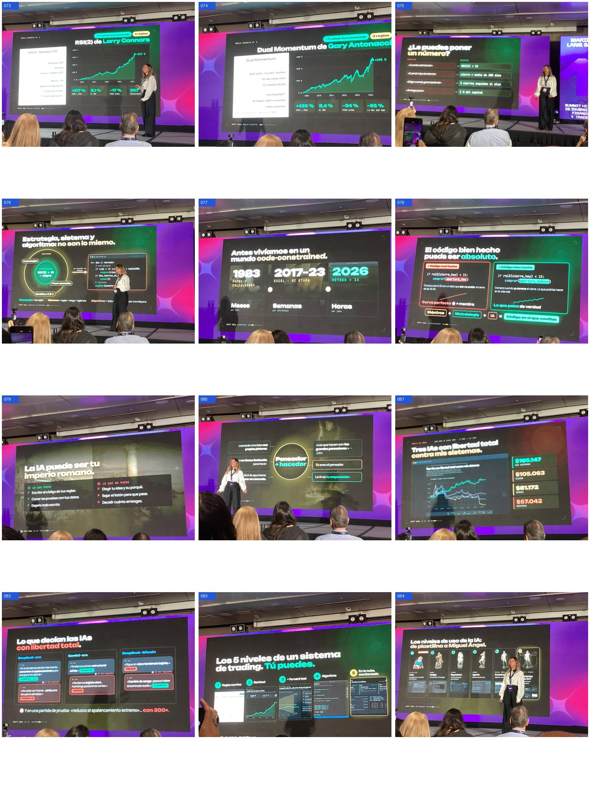
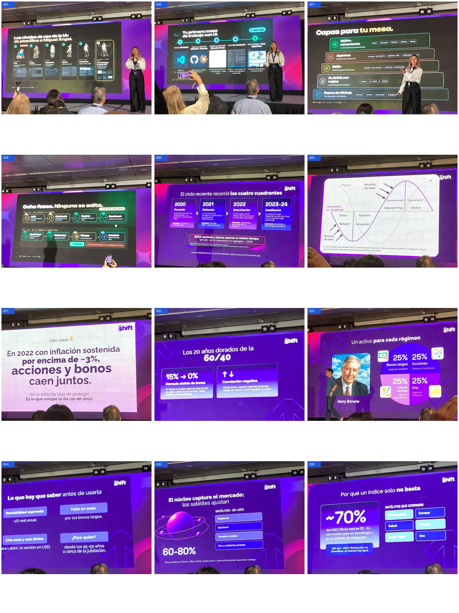
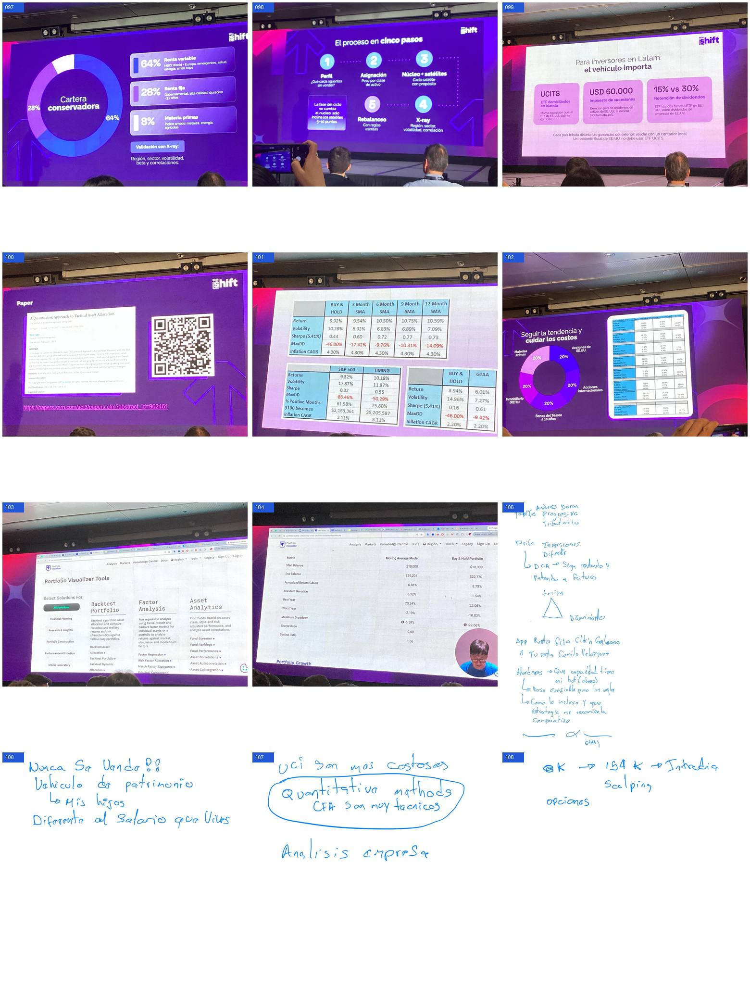
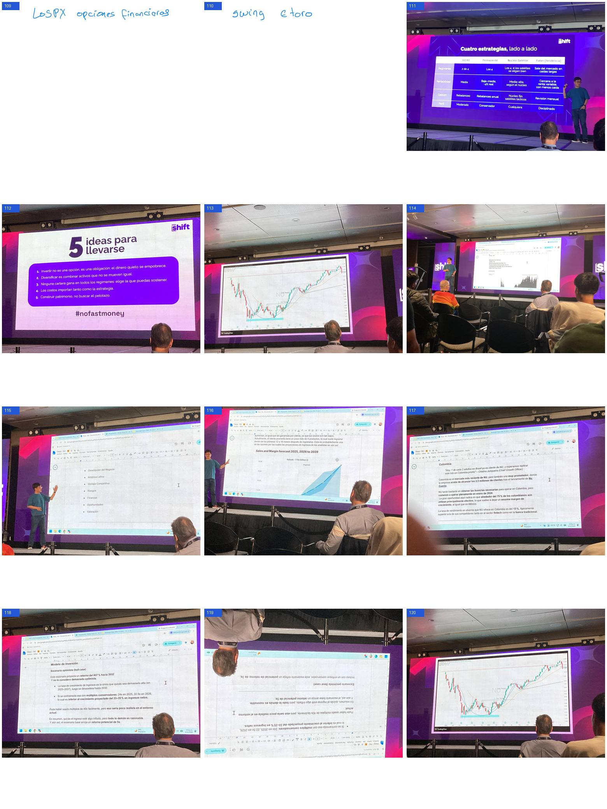
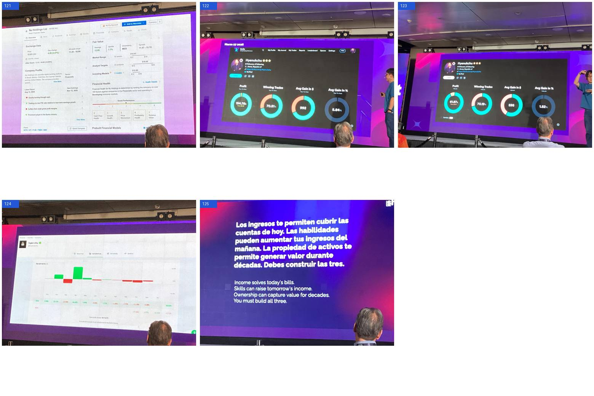
